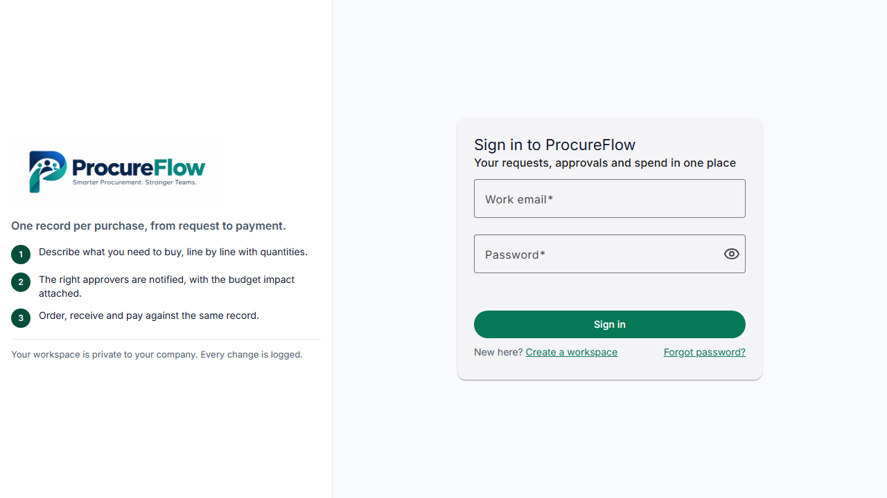
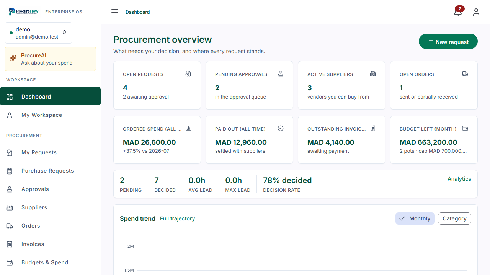
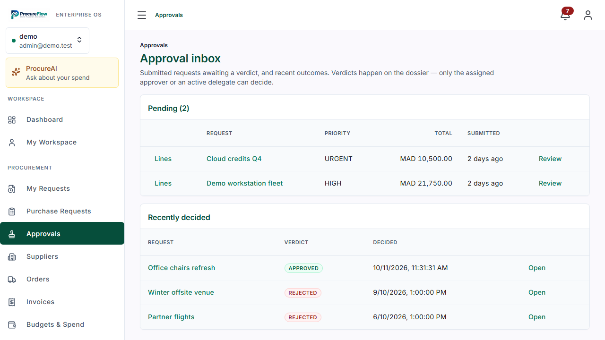
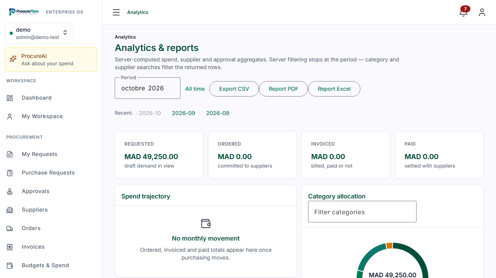

# Demo walkthrough (5 minutes, synthetic data only)

The `demo` workspace is seeded by `DemoSeeder` (dev profile only — never
active in tests or production) with six months of history: 6 users, 3
departments, 5 suppliers with scorecards, 7 budget pots, 12 requests in
every state, 4 orders, 2 invoices, a full audit trail and populated
inboxes. Everything here is fictional. **Password for all six accounts:
`ProcureFlow-2026!`** (demo-only; never reuse in production).

> Rotation policy: the demo password is a shared secret the moment it
> appears in a screenshot, recording, or shared environment. Before any
> shared demo, change it via `change-password` on all six accounts (you know
> the current one, so no reset flow is needed). Reseeding (`docker compose
> down -v` plus a dev-profile run) starts clean but restores this default —
> it is not rotation. Never point a shared demo at a
> database holding real tenant data.

```bash
# One-shot seed against the compose database (mail stays suppressed):
MAIL_PROVIDER=log docker compose run --rm -e SPRING_PROFILES_ACTIVE=dev backend
docker compose up -d --build   # backend :8081, frontend :4200
# open http://localhost:4200
```

The seed is idempotent (skips when `admin@demo.test` exists) and
backdates historical chains to 2026-05..2026-09, so Analytics shows a
real trajectory while the current month stays live for the walkthrough:

| Minute | As | Do |
|---|---|---|
| 1 | `admin@demo.test` | Dashboard → Suppliers → Requests; note the full rail |
| 2 | `approver@demo.test` | Approvals inbox → open *Demo workstation fleet* → Approve with a comment |
| 3 | `admin@demo.test` | Orders → create from the approved *Office chairs refresh* → Send; Invoices → book → pay |
| 4 | `finance@demo.test` | Budgets & Spend → New pot; Analytics → spend trajectory |
| 5 | `auditor@demo.test` | Audit Logs → expand a row (before/after payloads); try any write (honest 403) |

Extras: `member@demo.test` sees 9 rail entries and a 403 behind `/budgets`;
`admin@demo.test` → ProcureAI Copilot (needs `GROQ_API_KEY` +
`AI_ENABLED=true` in `.env`, otherwise an honest disabled message);
Users & Roles creates accounts with any of the six roles.

## What you'll see (live captures from the seed above)









## Reset procedure

Demo data lives in the shared `pgdata` volume alongside everything else.
Plain `DELETE FROM tenants` fails: several foreign keys are NO ACTION by
design (users, suppliers, requests), so reset in dependency order:

```bash
docker compose exec postgres psql -U procureflow -d procureflow \
  -c "DELETE FROM invoice_payments WHERE invoice_id IN (SELECT id FROM invoices WHERE tenant_id = (SELECT id FROM tenants WHERE slug = 'demo'));" \
  -c "DELETE FROM invoices WHERE tenant_id = (SELECT id FROM tenants WHERE slug = 'demo');" \
  -c "DELETE FROM purchase_orders WHERE tenant_id = (SELECT id FROM tenants WHERE slug = 'demo');" \
  -c "DELETE FROM approval_assignments WHERE tenant_id = (SELECT id FROM tenants WHERE slug = 'demo');" \
  -c "DELETE FROM audit_events WHERE tenant_id = (SELECT id FROM tenants WHERE slug = 'demo');" \
  -c "DELETE FROM approval_steps WHERE workflow_id IN (SELECT id FROM approval_workflows WHERE tenant_id = (SELECT id FROM tenants WHERE slug = 'demo'));" \
  -c "DELETE FROM invites WHERE tenant_id = (SELECT id FROM tenants WHERE slug = 'demo');" \
  -c "DELETE FROM approval_decisions WHERE tenant_id = (SELECT id FROM tenants WHERE slug = 'demo');" \
  -c "DELETE FROM purchase_requests WHERE tenant_id = (SELECT id FROM tenants WHERE slug = 'demo');" \
  -c "DELETE FROM suppliers WHERE tenant_id = (SELECT id FROM tenants WHERE slug = 'demo');" \
  -c "DELETE FROM supplier_categories WHERE tenant_id = (SELECT id FROM tenants WHERE slug = 'demo');" \
  -c "DELETE FROM departments WHERE tenant_id = (SELECT id FROM tenants WHERE slug = 'demo');" \
  -c "DELETE FROM roles WHERE tenant_id = (SELECT id FROM tenants WHERE slug = 'demo');" \
  -c "DELETE FROM users WHERE tenant_id = (SELECT id FROM tenants WHERE slug = 'demo');" \
  -c "DELETE FROM tenants WHERE slug = 'demo';"
```

then re-run the seed command above. Never point a reset at a non-demo
tenant. (Unrelated `zz-*`/`probe-*` tenants in the dev volume are
accumulated live-test debris, not seed data; leave them or drop them the
same way.)
